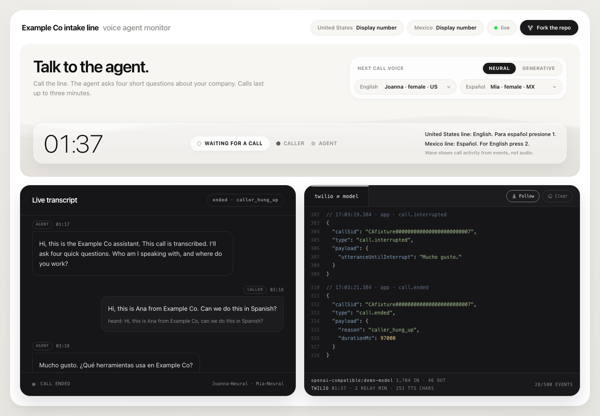

# ☎️ Switchboard


> **"Switchboard Operators, ca. 1915."** Operators connecting calls by hand. Photograph from the **Bettmann** collection, via [Getty Images](https://www.gettyimages.com.mx/detail/fotograf%C3%ADa-de-noticias/switchboard-operators-ca-1915-fotograf%C3%ADa-de-noticias/514874606?show-asset-scope=true).

Switchboard connects a Twilio phone number to the AI model of your choice. It runs the conversation and shows each call live in a browser dashboard.

```bash
git clone https://github.com/jcgaal/switchboard && cd switchboard
cp .env.example .env && pnpm install && pnpm dev
```

---

## Why use Switchboard

Hosted voice-agent platforms bundle the model, the voices and the monitoring into one product with per-minute pricing. Switchboard is a small Node service you host yourself, and each of those parts is configuration you control.

**Any model.** Anthropic, OpenAI, Gemini, or any server that implements the OpenAI chat API, including a model on your own hardware. Changing provider means changing one environment variable.

**Agents are files.** Each agent is a YAML file and a prompt. Greetings, languages, voices, the keypad menu, recognition vocabulary and dashboard text are defined there, not in code.

**Full visibility.** The dashboard shows the transcript, every Twilio and model event, token usage and call minutes while the call is in progress. When an agent answers badly, you can see what it heard and what it was sent.

**Multilingual.** An agent can support any number of languages, each with its own voice, and switch during a call when the caller asks.

Typical uses include after-hours reception, intake lines that collect details before a callback, appointment reminders, and comparing models on real phone audio.

---

## Quickstart

You need Node 22 or later, pnpm 10 (run `corepack enable` to get the version this repository pins), and a Twilio account with a voice-capable number.

**1. Install**

```bash
git clone https://github.com/jcgaal/switchboard && cd switchboard
cp .env.example .env
pnpm install
```

**2. Configure `.env`**

The minimum:

```bash
TWILIO_ACCOUNT_SID=AC...
TWILIO_AUTH_TOKEN=...
OBSERVER_TOKEN=a-long-random-string
```

The default agent, `intake`, needs a model key: `ANTHROPIC_API_KEY` for the default model. To test the phone line without a model, set `AGENT=echo`. That agent repeats what the caller says.

**3. Start the service**

```bash
pnpm dev
```

The server listens on port `8080` and the dashboard on `http://localhost:5173`. Open the dashboard once as `http://localhost:5173/?token=<OBSERVER_TOKEN>`. The token is exchanged for a cookie and removed from the URL.

**4. Expose port 8080 over HTTPS**

Twilio needs a public HTTPS URL that reaches port `8080`. A tunnel is enough for development:

```bash
ngrok http 8080
# or
cloudflared tunnel --url http://localhost:8080
```

For a permanent setup, see [Deployment](#deployment).

**5. Configure the Twilio number**

In the Twilio Console, enable ConversationRelay and accept the AI features addendum under Voice settings ([onboarding guide](https://www.twilio.com/docs/voice/conversationrelay/onboarding)). Then open the number's **Voice** configuration and set **A call comes in** to Webhook, `https://<your-host>/voice`, **HTTP POST**.

**6. Call the number**

The agent answers with its greeting and the conversation appears on the dashboard.

Requests without a valid Twilio signature are rejected. `SKIP_TWILIO_SIGNATURE=true` disables that check for local protocol testing only. Do not set it on a server reachable from the internet.

---

## Choosing a model

`MODEL` takes the form `provider:model-id`. Switching providers requires no code changes.

```bash
MODEL=anthropic:claude-sonnet-5-5        # ANTHROPIC_API_KEY
MODEL=openai:<model-id>                  # OPENAI_API_KEY
MODEL=gemini:<model-id>                  # GEMINI_API_KEY
MODEL=openai-compatible:<model-id>       # OPENAI_BASE_URL, plus OPENAI_API_KEY if the server requires one
```

`openai-compatible` works with any server that implements the OpenAI chat API, such as Ollama, vLLM, OpenRouter, Groq or Together. A local model through Ollama:

```bash
ollama pull <model>
MODEL=openai-compatible:<model>
OPENAI_BASE_URL=http://localhost:11434/v1
```

Latency matters more on a phone call than in a chat window. A model that takes several seconds to start responding feels broken to a caller, however good the answer. Smaller, faster models often make better voice agents.

`FAST_MODEL` is optional. When set, each caller turn is also sent to that model to correct spelling and misheard names. The correction appears on the dashboard only. The agent always works from the raw transcript and never waits for it.

An unknown provider or a malformed `MODEL` stops the server at startup. A missing key is reported by `/api/status`, and calls that reach the model without one get the agent's spoken apology.

---

## Writing an agent

An agent is a folder containing `agent.yaml` and, for model-backed agents, `prompt.md`. Three examples ship in `agents/`:

| Agent      | Purpose                                                                                                     |
| ---------- | ----------------------------------------------------------------------------------------------------------- |
| `echo`     | Repeats the caller. No model required, so it only incurs Twilio charges. Use it to test a number.           |
| `intake`   | Intake line for the fictional Example Co. Four questions, English and Spanish, with a keypad language menu. |
| `reminder` | Appointment line for the fictional Northside Clinic. Confirms, reschedules or cancels.                      |

An abridged `agents/intake/agent.yaml`:

```yaml
name: intake
display_name: Example Co intake line
default_language: es-MX
time_limit_seconds: 180

languages:
  en-US:
    tag: en
    greeting: "Hi, this is the Example Co assistant. This call is transcribed. ..."
    closing_time_limit: "We've reached the time limit. Thanks for calling."
    error_apology: "Sorry, something went wrong. Could you say that again?"
    default_voice: Amazon:Joanna-Neural
  es-MX:
    tag: es
    greeting: "Hola, soy el asistente de Example Co. ..."
    # ...

language_menu:
  enabled: true
  options: { "1": es-MX, "2": en-US }
  prompts:
    en-US:
      - { language: es-MX, text: "Para español presione 1." }

transcription:
  provider: Deepgram
  model: nova-3-general
  hints: [Example Co, HubSpot, Salesforce]

pronunciation:
  "Example Co": "Example Company"

dashboard:
  headline: "Talk to the agent."
  subline: "Call the line. The agent asks four short questions about your company."

prompt: prompt.md
```

The main fields:

- **`languages`** lists each supported language by locale, with its own greeting, closing line, error apology and default voice. There is no limit on the number of languages.
- **`tag`** drives language switching. The model is instructed to begin each reply with a tag such as `[es]`. The tag is removed before speech, and a different tag switches the voice mid-call.
- **`language_menu`** adds an optional keypad menu before the greeting. `NUMBER_LANGUAGES` in `.env` can also assign a starting language to each dialed number.
- **`transcription.hints`** lists terms the speech recognizer should expect, such as brand and product names.
- **`pronunciation`** changes how text is spoken without changing how it is recorded. The transcript and the model's history keep "Example Co"; the caller hears "Example Company".
- **`prompt.md`** is the system prompt, written in plain prose.

Select the agent with `AGENT=<folder name>`.

**Private agents.** Keep production agents outside the repository. Set `AGENTS_DIR` to any folder, or use `private-agents/` in the repository root, which is already excluded by `.gitignore`:

```bash
AGENTS_DIR=../my-agents
AGENT=front-desk
```

Agent files are validated at startup. An invalid file stops the server with the name of the field at fault.

---

## Voices and the picker

ConversationRelay handles speech synthesis. Switchboard includes a catalog of Amazon voices on the neural and generative engines. Each language starts with the `default_voice` from the agent file.

The dashboard's voice picker has one slot per agent language. Changes apply from the next call. Each voice is checked against the slot's language and the selected engine, so a Spanish slot cannot be given an English voice.

Access to the picker:

- With `CONTROL_TOKEN` set, open the dashboard with `?control=<token>` to enable changes.
- With `PUBLIC_VOICE_PICKER=true`, anyone who can view the dashboard can change voices. Use this for demos only.
- With neither, the picker is read-only.

Voice selections are held in memory and reset to the agent defaults on restart.

---

## The dashboard

<picture>
  <source media="(prefers-color-scheme: dark)" srcset="docs/dashboard-dark.png">
  
</picture>

- **Header.** The agent's display name, the public numbers from `PUBLIC_NUMBERS` (shown on request), connection status, and a fork link built from `REPO_URL`.
- **Summary panel.** Activity wave, headline and subline, voice picker, call timer, and the keypad menu for each number.
- **Live transcript.** Caller and agent turns as they happen. Interrupted replies are marked. With transcript correction enabled, the corrected sentence appears above what was heard.
- **Event stream.** Every webhook, TwiML response, Twilio message and model request, with direction and raw JSON.

The activity wave is driven by events, not audio. Switchboard never receives call audio, so the wave estimates who is speaking from transcripts and reply text.

The dashboard follows the system light or dark setting. Concurrent calls are tracked separately and can be selected from the transcript header.

**Access control.** The dashboard, `/events` and `/api/status` are closed unless `OBSERVER_TOKEN` is set and supplied once as `?token=`, or `OBSERVER_PUBLIC=true` opens them to everyone. Caller numbers are masked to the last four digits unless `SHOW_CALLER_NUMBERS=true`. The event stream only includes events from after the page connected. Set `EVENT_REPLAY=200` to send the last 200 events to late joiners.

---

## Cost per call

The footer of the event stream shows running totals for the selected call:

| Field                 | Meaning                                                                                                                 |
| --------------------- | ----------------------------------------------------------------------------------------------------------------------- |
| model id, `in`, `out` | Input and output tokens across all model requests in the call, including transcript correction when `FAST_MODEL` is set |
| call duration         | Time from the start of the call to its end, or to now while live                                                        |
| relay min             | ConversationRelay minutes, rounded up                                                                                   |
| tts chars             | Characters sent to speech synthesis                                                                                     |

Prices change often, so the dashboard reports usage, not cost. Current rates:

- Twilio voice and ConversationRelay, billed separately: [twilio.com/voice/pricing](https://www.twilio.com/en-us/voice/pricing).
- Model tokens: your provider's pricing page. Local models have no per-token cost.

These figures are estimates derived from events. Your Twilio and model provider invoices are authoritative.

---

## Deployment

Switchboard runs as a single Node process serving the webhook, the call WebSockets and the dashboard. Requirements for the host:

- **HTTPS with WebSocket support.** Twilio opens `wss://<your-host>/ws` for each call. TLS may terminate at a proxy.
- **A single, always-on instance.** Each call holds a WebSocket and in-memory state for its duration, and voice selections live in the process. Avoid scale-to-zero, serverless functions and multiple replicas behind a load balancer. One small instance handles many concurrent calls.
- **One hostname.** The webhook derives the WebSocket URL from the host Twilio called, so no hostname is configured.

**Concurrent calls.** `MAX_CONCURRENT_CALLS` (default `10`) limits how many calls run at once. Callers beyond the limit hear a busy signal, and Twilio does not bill rejected calls. Set it to `0` to remove the limit.

**Restarts.** On `SIGTERM` or `SIGINT` the server stops accepting calls and waits for live calls to finish, up to the agent's time limit plus ten seconds. Give the platform at least that long before it force-stops the process: `docker stop -t 200`, or `kill_timeout`, which `fly.toml.example` sets to 200 seconds. A second signal exits immediately.

| Target               | Setup                                                                                                                                                                                                                                |
| -------------------- | ------------------------------------------------------------------------------------------------------------------------------------------------------------------------------------------------------------------------------------ |
| Docker               | `docker build -t switchboard .` then `docker run -p 8080:8080 --env-file .env switchboard`. The image builds the server and dashboard, runs as a non-root user and exposes `PORT`.                                                   |
| Fly.io               | `cp fly.toml.example fly.toml` and set `app`. Then run `fly launch --copy-config --no-deploy`, `fly secrets set TWILIO_AUTH_TOKEN=... OBSERVER_TOKEN=...` and `fly deploy --ha=false`. The example config keeps one machine running. |
| Render               | Web service from the repository. Build command `pnpm install --frozen-lockfile && pnpm build`, start command `pnpm start`, on an instance type that does not spin down.                                                              |
| Replit               | Reserved VM only. Autoscale deployments can scale to zero and drop calls.                                                                                                                                                            |
| Serverless functions | Not supported. Each call holds a WebSocket for its full duration.                                                                                                                                                                    |
| Other hosts          | `pnpm install --frozen-lockfile && pnpm build && pnpm start` behind a TLS proxy that forwards WebSockets.                                                                                                                            |

The Docker image includes the example agents. Mount your own agents and set `AGENTS_DIR` so that private prompts stay out of the image:

```bash
docker run -p 8080:8080 --env-file .env -v "$PWD/private-agents:/agents:ro" -e AGENTS_DIR=/agents -e AGENT=front-desk switchboard
```

**Twilio configuration.** Set the number's voice webhook to `https://<your-host>/voice` with HTTP POST, as in the quickstart. A TwiML Bin with a short `<Say>` message can be added as the **Primary handler fails** fallback, so callers hear a message if the service is unavailable.

### Troubleshooting

- **Every call fails with 403 and an `error.signature` event.** The signature is checked against `https://<Host header><path>`. The URL in the Twilio Console must match the public address exactly, and any proxy or tunnel in front must pass the original `Host` header through. Options that rewrite it, such as ngrok's `--host-header=rewrite`, break validation.
- **The call connects, then drops or stays silent.** ConversationRelay is not enabled, or the AI features addendum has not been accepted, in the Twilio Console.
- **Callers hear a busy signal.** The server is at `MAX_CONCURRENT_CALLS` or is shutting down. The dashboard shows a `call.rejected` event with the reason.

---

## MCP server

`tools/mcp-server.ts` is an optional [MCP](https://modelcontextprotocol.io) server. It lets an MCP client such as Claude Desktop or Claude Code inspect calls on a running Switchboard instance.

| Tool          | Returns                                                                       |
| ------------- | ----------------------------------------------------------------------------- |
| `list_calls`  | Calls seen so far, newest first, with turn counts and usage                   |
| `get_call`    | A call's transcript, voices and usage, by call SID                            |
| `list_agents` | Agent folders in `AGENTS_DIR`, whether each is valid, and which one is active |

Run `pnpm install` in the checkout first. A relative `AGENTS_DIR` resolves against the checkout, as it does for the server.

The MCP server subscribes to `/events` using `OBSERVER_TOKEN`, so it only sees calls that occur while it is connected. Set `EVENT_REPLAY` on the server, for example `EVENT_REPLAY=500`, to include recent history at startup. Calls are not persisted, and a server restart clears them.

```json
{
  "mcpServers": {
    "switchboard": {
      "command": "/path/to/switchboard/node_modules/.bin/tsx",
      "args": ["/path/to/switchboard/tools/mcp-server.ts"],
      "env": {
        "SWITCHBOARD_URL": "https://your-host",
        "OBSERVER_TOKEN": "your-observer-token"
      }
    }
  }
}
```

---

## How it works

```
 caller ── phone ──▶ Twilio ──── POST /voice ─────▶ switchboard
                       │   ◀── TwiML: menu, voices ──   │
                       │                                │
                       │  ConversationRelay  wss://…/ws │
                       │  speech to text ── prompt ───▶ │ ── messages ──▶ model
                       │  text to speech ◀── tokens ──  │ ◀── stream ────
                       ▼                                │
                     caller                             │ every step
                                                        ▼
                                          /events ──▶ dashboard
```

1. Twilio posts the incoming call to `/voice`. Switchboard verifies the signature and returns TwiML with the voices, transcription settings and, if configured, the keypad menu.
2. Twilio opens a WebSocket to `/ws`. ConversationRelay performs speech recognition and synthesis, so Switchboard only handles text.
3. Each completed caller utterance is sent to the model with the call history. Tokens are streamed to Twilio as they arrive, so speech starts before the reply is complete. Every reply ends with a final empty message, including when the model fails or the time limit is reached.
4. If the caller interrupts, the reply is stopped and the history keeps only the portion the caller heard.
5. Each step is recorded as an event, written as a JSON line to the server log and broadcast to dashboards on `/events`.

There is no database. Call state lives in memory for the duration of the call. Switchboard does not record audio.

---

## House rules

Report security problems privately, as described in [SECURITY.md](SECURITY.md).

Tell callers at the start of every call that they are speaking with an AI. The greeting is the natural place. The example greetings are deliberately short, so add this to your own.

Transcription and consent laws vary by jurisdiction, and some require consent from every party. The example greetings state that the call is transcribed. Keep a statement like that in yours.

Do not configure an agent to impersonate a real person, and do not use Switchboard to call people who have not asked to be contacted.

The dashboard shows live transcripts. Keep `OBSERVER_TOKEN` set to a long random value, and leave caller masking on unless you have a specific need.

---

## License

MIT. See [LICENSE](LICENSE). Copyright (c) 2026 JC Gaal ([@jcgaal](https://github.com/jcgaal)).

The photograph is not covered by the MIT license. It belongs to its rights holder and is credited above.
